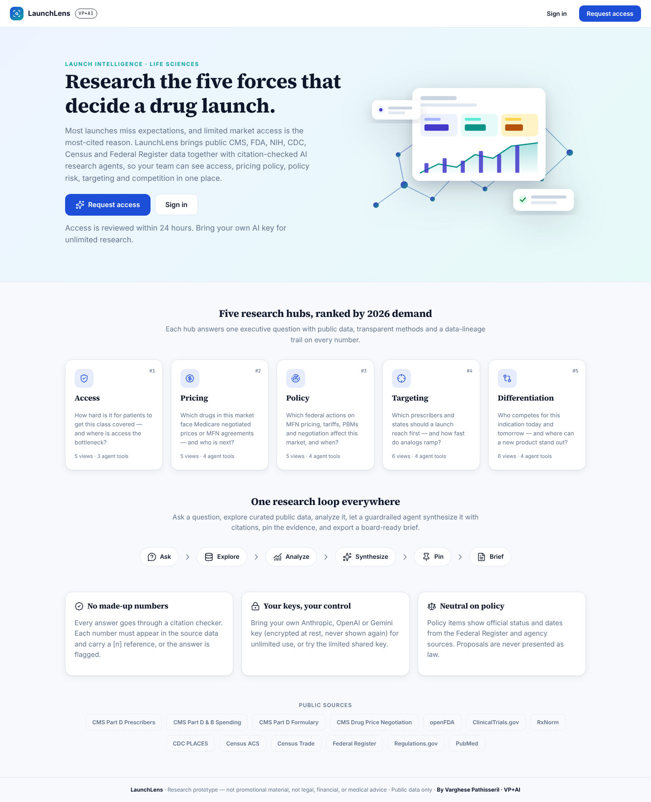
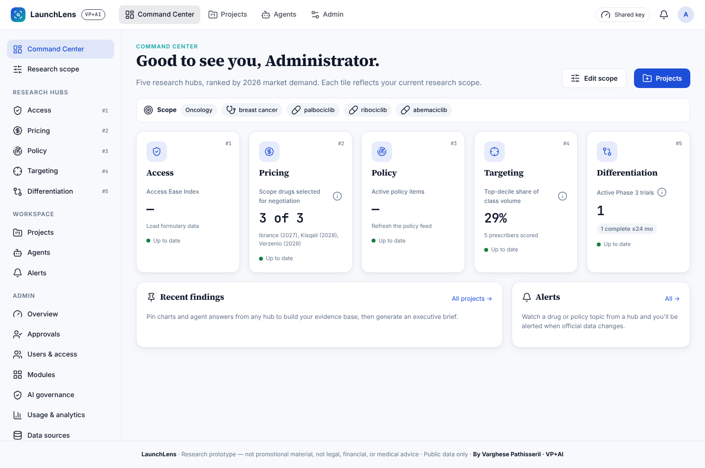
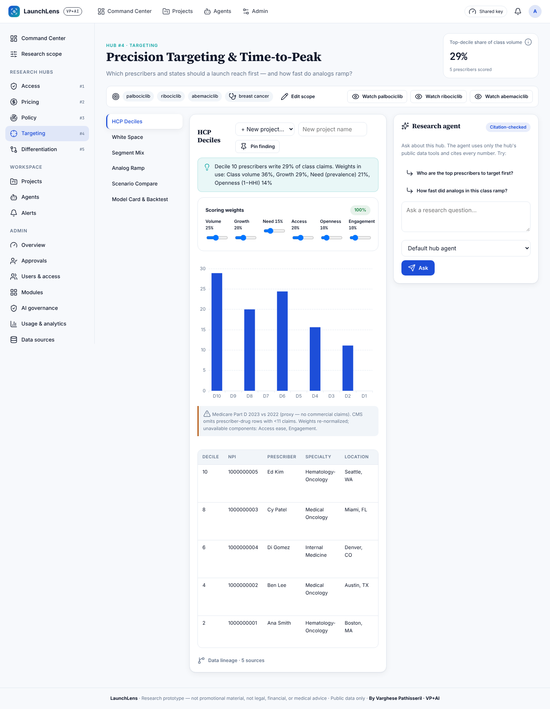
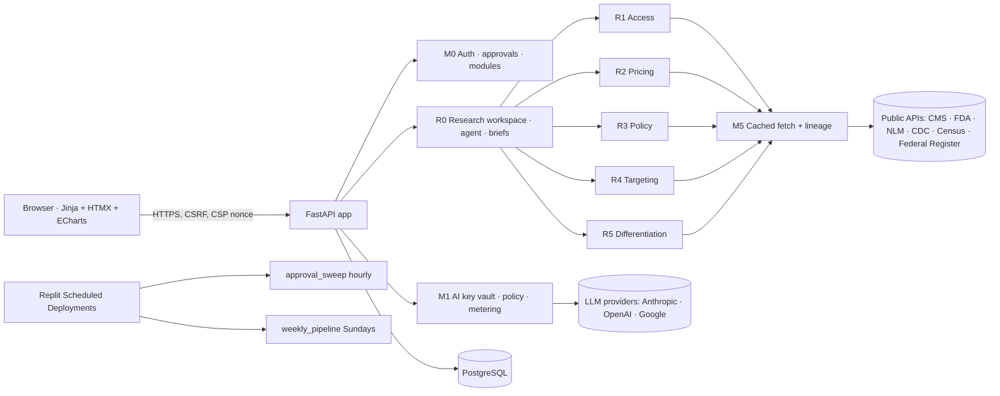

# LaunchLens — Launch Intelligence Research Workbench

**Research the five forces that decide a US drug launch, using public data and citation-checked AI agents.**
By Varghese Pathisseril · VP+AI



## The problem
More drug launches miss expectations than meet them. Industry research names **limited market access**, **poor market
understanding** and **weak differentiation** as the leading causes. In 2026, pricing policy (IRA Medicare negotiation, MFN
pricing), Section 232 tariffs and PBM reform are reshaping launch economics at the same time.

LaunchLens gives commercial, access and strategy teams one research workbench for the **five most in-demand questions**:

| # | Hub | Executive question | Public data |
|---|-----|--------------------|-------------|
| 1 | **Market Access & Payer Barriers** | How hard is it to get this class covered, and where is access the bottleneck? | CMS Part D formulary files, Part D prescribers, Census ACS |
| 2 | **Drug Pricing Policy · IRA + MFN** | Which drugs face Medicare negotiated prices or MFN agreements, and who is next? | CMS Negotiation Program publications, Part D/B spending, Drugs@FDA |
| 3 | **Policy Convergence Radar** | Which federal actions on MFN, tariffs, PBMs and negotiation affect us, and when? | Federal Register, Regulations.gov, Census trade (HS 30) |
| 4 | **Precision Targeting & Time-to-Peak** | Which prescribers and states first, and how fast do analogs ramp? | CMS Part D prescribers (2 vintages), CDC PLACES, ACS, R1 access |
| 5 | **Market Understanding & Differentiation** | Who competes today and tomorrow, and where can we stand out? | openFDA labels/FAERS, ClinicalTrials.gov, RxNorm, PubMed, Part D/B spending |

Every hub follows the same loop: **Ask → Explore → Analyze → Synthesize (AI, cited) → Pin → Brief.**


<sub>UI previews here were rendered with test fixtures. On Replit the hubs query live public APIs.</sub>

## What makes it stand out
- **No made-up numbers.** The research agent runs read-only hub tools on the server, passes the model only numbered,
  sourced facts, then a **citation verifier** checks that every `[n]` maps to a source and that every number in the answer
  appears in the tool output. If the check fails, the agent retries once, then shows a warning badge.
- **Data lineage on every view.** Each chart, KPI and pinned finding lists its dataset, vintage, row filter and retrieval
  time. CMS small-cell suppression (<11) is honored and never imputed.
- **Transparent models.** The Access Ease Index, the negotiation-candidate score and the HCP opportunity score are all
  formula-based with adjustable weights. The targeting model is backtested (score on year t−1, measure capture of year-t
  growth, report lift).
- **Governed AI.** Users must set up AI access at first login. **Bring your own key** (Anthropic, OpenAI or Gemini;
  Fernet-encrypted; validated with a free model-list call) gives unlimited use. The **shared default key** is limited
  by an admin policy: model allowlist, max tokens per call, calls per day and a monthly budget. Prompt caching, model
  routing by task and a 24-hour response cache keep cost down.
- **Neutral on policy.** Items carry official status and dates; proposals are never shown as law; admin-added items must
  cite a `.gov` source.
- **Executive UX.** Four themes (Clinical Clean → Executive Slate → Precision Pharma → Midnight Analytics), self-hosted
  Inter / Source Serif 4 / JetBrains Mono fonts, Lucide icons, ECharts, WCAG-minded contrast and keyboard focus.



## Architecture

- **Stack:** Python 3.12, FastAPI, SQLAlchemy 2, PostgreSQL (SQLite locally), Jinja2 + HTMX, ECharts, Lucide.
- **Module docs** (the spec the app was built from): `CLAUDE.md` + `docs/modules/*.md`. **Decisions:** `docs/DECISIONS.md`.

## About page
The in-app **/about** page is the single source of truth for what LaunchLens is, its hubs, AI key policy
(live shared-key limits), research profiles, data sources with refresh cadence, and limitations.

## Run locally
```bash
pip install -r requirements-dev.txt
cp .env.example .env          # set ADMIN_PASSWORD at minimum
make dev                      # http://localhost:8000  (admin: ADMIN_EMAIL / ADMIN_PASSWORD, forced change on first login)
make check                    # ruff · bandit · pip-audit · pytest
```

## Deploy: GitHub → Replit
1. **Import:** Replit → *Create Repl* → *Import from GitHub* → `vpathisseril/launchlens`.
2. **Database:** Tools → *PostgreSQL*, which sets `DATABASE_URL`.
3. **Secrets** (Tools → Secrets): `ENV=prod`, `SECRET_KEY`, `FERNET_KEY`, `ADMIN_EMAIL`, `ADMIN_PASSWORD`, `BASE_URL`
   (your `.replit.app` URL), plus optional `DEFAULT_ANTHROPIC_KEY`, `OPENFDA_API_KEY`, `CENSUS_API_KEY`,
   `REGULATIONS_API_KEY` and `SMTP_*`. Generate keys:
   `python -c "import secrets;print(secrets.token_urlsafe(48))"` ·
   `python -c "from cryptography.fernet import Fernet;print(Fernet.generate_key().decode())"`
4. **Verify sources:** in the Replit Shell run `make sources`. Every row should be `OK`.
5. **Deploy:** *Deploy → Autoscale* (uses `.replit`). Then add two **Scheduled** deployments:
   `python -m scripts.weekly_pipeline` (**weekly**, Sundays 5:00 AM ET: re-fetches every public source, refreshes the
   policy feed and pre-loads every hub view for the starter scopes and all saved user scopes) and
   `python -m scripts.approval_sweep` (hourly). Admin → Data sources shows the last run, next due date, and a
   Fresh / Overdue badge per source (Overdue = not refreshed in 8 days). The Part D formulary (quarterly) and CMS
   negotiation data (Feb 1 / Nov 30) stay admin-loaded. Full guide: `docs/WEEKLY_OPERATIONS.md`.
6. **First run:** sign in as admin → change password → Admin → AI governance (set model prices; confirm the shared-key
   allowlist) → Admin → Data sources → *Refresh policy feed* → load a Part D formulary ZIP (official cms.gov URL) for R1.
7. **Smoke test:** `/health`, sign-up → pending, a shared-key quota hit, one question per hub, one exported brief.
8. **Releases:** push to `main` → CI green → in Replit's Git pane *Pull* → *Redeploy*.

## SDLC (how it was built)
| Phase | Artifact |
|------|----------|
| Requirements | `docs/modules/*.md`: user stories with Gherkin acceptance criteria |
| Design | `CLAUDE.md` guardrails, architecture above, `docs/DECISIONS.md` (ADRs), threat model in `docs/SECURITY_REVIEW.md` |
| Develop | Modules M0, M1, M5, R0, R1–R5, M2, M4 |
| Test | `tests/`: 39 acceptance tests mapped to stories, public APIs mocked with recorded-shape fixtures (respx), ~81% coverage |
| Quality & security | ruff, bandit, pip-audit (0 known vulns), gitleaks in CI, CSP with nonces, argon2id, CSRF, rate limits, audit log |
| Release | GitHub Actions CI → Replit Autoscale + Scheduled Deployments |

## Limitations (read before presenting numbers)
- Public data only. **Medicare Part D/B is a proxy** for the total market. Commercial claims are not public.
- CMS omits prescriber-drug rows with fewer than 11 claims. Results reflect only prescribers above that threshold.
- The negotiation-candidate score is an **estimate**, not a CMS determination (orphan, small-biotech and biosimilar-delay
  rules are not modeled).
- Negotiation-program rows were transcribed from official CMS publications (IPAY 2026–2028). Admins update them in
  Admin → Data sources as CMS publishes.
- Research prototype: not promotional material, not legal, financial or medical advice.

## Roadmap
Plan-enrollment weighting for R1 · Medicaid SDUD channel · Orange/Purple Book exclusivity cliff · Open Payments engagement
component · Congress.gov bill tracking · Alembic migrations · Playwright e2e in CI.

---
**By Varghese Pathisseril · VP+AI** — Data · AI · Analytics
